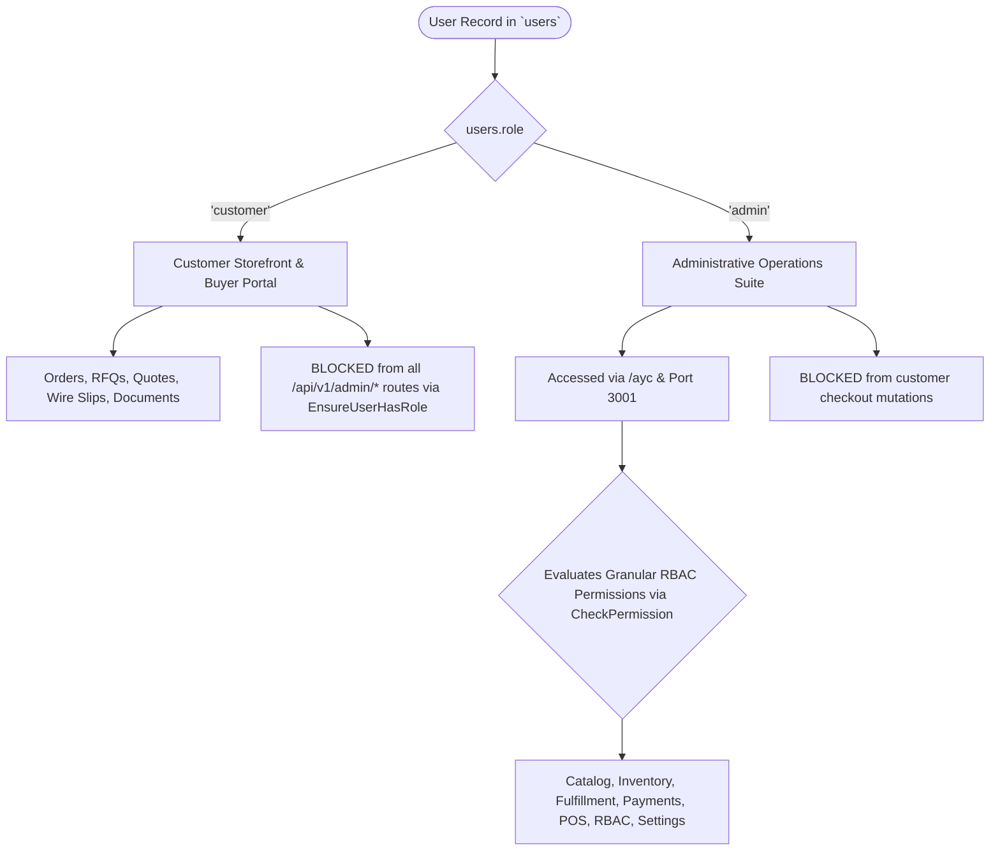

# AYC — User Roles, Permissions & Business Rules

## 1. Foundational Two-Role Architecture

Ayaan Clothing enforces strict role separation at the database layer. In `users.role`, every user is assigned exactly one foundational identity:
1. **`customer`**: External wholesale apparel buyers, retail chain representatives, and showroom counter buyers.
2. **`admin`**: Internal personnel (Operations, Logistics, Finance, Sales, Merchandising, Cashiers, and System Administrators).



---

## 2. Granular Administrative RBAC Matrix

Administrative staff members are assigned one or more administrative roles in `admin_roles`, which in turn grant atomic permissions defined in `role_permissions`.

### 2.1 Standard Pre-Seeded Roles
| Role Name | Slug | Primary Responsibilities | System Protected (`is_system`) |
|---|---|---|:---:|
| **Super Admin** | `super_admin` | Unrestricted access across all operational, financial, and governance modules | ✅ Yes |
| **Merchandiser** | `merchandiser` | Product catalog, media management, pricing tiers, and homepage merchandising | ❌ No |
| **Warehouse Operator** | `warehouse_operator` | Warehouse stock adjustments, physical inventory audits, and logistics packing | ❌ No |
| **Cashier / POS Operator** | `cashier` | Showroom counter order creation, quick customer registration, and cash tender | ❌ No |
| **Finance & Accounts Auditor** | `finance_auditor` | Bank wire review, payment verification, order confirmation, and COGS reports | ❌ No |
| **Coupon Sales Manager** | `coupon_sales` | Sales and revenue reports strictly scoped to assigned promotional coupons | ❌ No |

### 2.2 Complete Atomic Permissions Catalog
```
CATALOG & MERCHANDISING
├── product.view                   # View catalog items and statistics
├── product.create                 # Create new wholesale products
├── product.edit                   # Modify descriptions, specifications, tiers, visibility
├── product.delete                 # Soft-delete products and release URLs/SKUs
├── product.image.upload           # Upload and crop 4:5 fashion photography
├── product.image.delete           # Remove product gallery images
├── product.image.reorder          # Change photo sequence ordering
├── category.create / edit / delete # Manage garment categories
├── brand.create / edit / delete   # Manage garment brands and labels
└── homepage.view / banner.edit / product.manage # Merchandising hero, ticker, featured grids

INVENTORY & LOGISTICS
├── inventory.view                 # Inspect multi-warehouse inventory balances
├── inventory.view_warehouse       # View physical facility profiles
├── inventory.adjust               # Record audited stock increases, write-offs, returns
├── inventory.audit                # View historical inventory adjustment logs
├── shipment.create                # Issue Aramex air freight AWB consignments
└── tracking.refresh               # Re-sync international consignment tracking

ORDERS & POINT OF SALE
├── order.view                     # View order headers and summaries
├── order.view_customer            # View buyer billing and shipping details
├── order.view_items               # Inspect line items and carton assortment breakdowns
├── order.update_status            # Manually transition order workflow state
├── order.update_fulfillment       # Update tracking number and carrier details
├── order.shipping.update          # Revise custom shipping quotes
├── pos.view                       # Access and navigate POS terminal screen
├── pos.create                     # Submit showroom counter orders
└── pos.discount                   # Apply manual percentage or fixed counter discounts

FINANCE & COMMERCIAL DOCUMENTS
├── payment.receipt.verify         # Approve bank wire slips & trigger stock deduction
├── payment.receipt.reject         # Reject bank wire slips with required reason
├── document.view                  # View commercial export document payloads
├── document.download              # Download official vector PDF streams
├── document.generate              # Trigger asynchronous PDF document compilation
├── analytics.dashboard.view       # View executive KPI cards
├── analytics.sales.view           # Inspect gross sales and profit analytics
└── audit.view                     # Inspect activities system audit trail

COUPONS & CAMPAIGNS
├── coupon.view                    # View promotional coupon codes
├── coupon.create / edit / delete  # Manage promotional discounts and validity
├── coupon.activate / deactivate   # Toggle active campaign status
└── coupon.bind                    # Assign coupons to sales representatives

SYSTEM GOVERNANCE & RBAC
├── admin.view                     # View administrator user accounts
├── admin.create / edit / delete   # Create and manage staff accounts
├── admin.reset_password           # Reset staff login credentials
├── role.view / create / edit / delete # Manage custom RBAC roles
├── role.assign / unassign         # Attach/detach roles to administrative users
├── permission.view                # Inspect atomic permissions catalog
├── permission.manage              # Synchronize permissions to roles
└── settings.view / edit           # View and update business profile, banking, legal pages
```

---

## 3. Data Ownership & Authorization Rules

### 3.1 Customer Data Ownership Rules
1. **Self-Service Isolation**: A customer user can **only** view or mutate their own records:
   - Orders: `orders.user_id === auth()->id()`
   - Addresses: `addresses.user_id === auth()->id()`
   - Carts: `carts.user_id === auth()->id()`
   - Quotes / RFQs: `quotes.user_id === auth()->id()`
2. **Document Access Control**:
   - Offer Sheets and Proforma Invoices can be downloaded at any time by the owning buyer.
   - Commercial Invoices (CI) can **only** be downloaded by the customer once payment has been verified (`payment_status === 'PAID'` or `status === 'CONFIRMED'`).
   - Administrators with `document.view` can access documents across all orders regardless of payment state.

### 3.2 Scoped Coupon Sales Representative Rules
1. **Strict Server-Side Scoping**: An administrator assigned to the `coupon_sales` role (or bound to specific coupons via `coupon_admin_bindings`) can **only** view orders where `orders.coupon_id` matches their bound coupons.
2. **Zero Leakage**: Unassigned orders, un-discounted wholesale orders, and orders attributed to other representatives are completely excluded by Eloquent query scopes.
3. **Immutability**: Representatives cannot modify orders or approve payments unless explicitly granted those distinct permissions.

---

## 4. Backend Enforcement vs. Frontend Visibility

| Capability | Frontend Presentation Layer | Backend Authoritative Layer |
|---|---|---|
| **Wholesale Unit Price** | Displays dynamic calculation for user feedback | Recalculated and enforced strictly on server via `OrderCalculationService`. Client prices ignored. |
| **MOQ Adherence** | Form validation disables "Add to Cart" if $Q < \text{MOQ}$ | HTTP 422 Unprocessable Content if $Q < \text{MOQ}$. |
| **Admin Navigation** | Sidebar hides links based on `user.permissions` array | Middleware `CheckPermission` aborts with HTTP 403 Forbidden. |
| **Bank Wire Approval** | "Verify Payment" button visible if permitted | `POST /admin/orders/{id}/payment/verify` requires `payment.receipt.verify`. |
| **Storefront Geo-Lock** | Displays 403 Access Restricted screen to visitors | Server proxy (`src/proxy.ts`) evaluates client IP against internal GeoIP check. |
